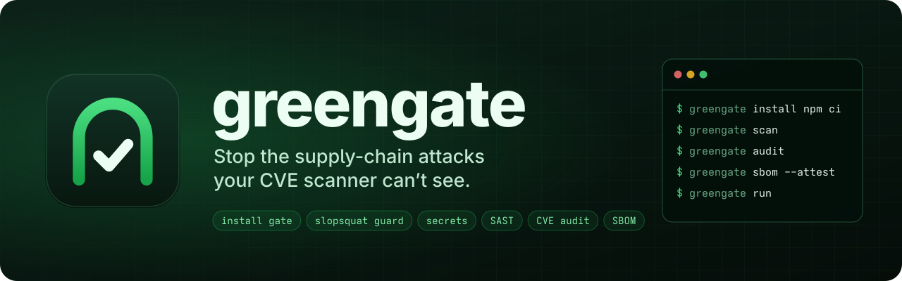

<p align="center">
  
</p>

# greengate

**Dependency checks and install protection for developers, CI, and coding agents.**

[](LICENSE)
[](https://github.com/greengate-dev/greengate/actions)
[](https://github.com/greengate-dev/greengate/releases/latest)
[](https://crates.io/crates/greengate)

[Documentation](https://greengate-dev.github.io/greengate) · [Configuration](docs/reference/config.md) · [CI integration](docs/guide/ci-integration.md) · [Limitations](docs/reference/limitations.md)

See the [changelog](CHANGELOG.md) for release changes and the [migration guide](docs/guide/migrating-to-0.4.md) when upgrading to 0.4.

greengate checks dependency changes, inspects install scripts, and restricts their access when Linux bubblewrap isolation is available. The same Rust CLI runs secret scanning, static application security testing (SAST), vulnerability audits, SBOM generation, and repository quality gates.

Use it to review what a dependency change introduces, gate an install, or check a command before a coding agent executes it. Reports distinguish findings from checks that could not complete, so missing security data is visible in CI.

## Install

Install the Linux x64 binary:

```bash
curl -fsSL https://github.com/greengate-dev/greengate/releases/download/v0.4.0/greengate-linux-amd64 -o greengate
sudo install -m 755 greengate /usr/local/bin/greengate
greengate --version
```

To build from a source checkout, run `cargo install --path . --locked`.

Published binaries are available for Linux x64, macOS Intel and Apple Silicon, and Windows x64 on the [releases page](https://github.com/greengate-dev/greengate/releases). Linux releases use musl; macOS and Windows use their native targets. For download commands and release verification, see [Getting started](docs/guide/getting-started.md).

The CLI itself needs no Node.js or Python runtime. Wrapped installs still need their package managers and build tools. Bubblewrap enables Linux isolation, Docker is required for image scanning, and cosign is required for SBOM signing and verification.

## Start with dependency checks

From a project with a supported lockfile:

```bash
greengate deps list
greengate deps review --base origin/main
greengate audit
```

`deps review` summarizes dependency changes, licenses, known advisories, release risk, and available fix guidance. `audit` checks registry dependencies recorded in supported dependency files, including unchanged dependencies. Offline audits use snapshots downloaded with `greengate db update`.

## Gate an install

```bash
greengate install --plan npm ci
greengate install --isolate bwrap npm ci
greengate install --pip .venv/bin/pip pip install -r requirements.txt
greengate install uv sync
greengate install cargo add serde
```

The install flow resolves a plan, applies dependency policy, fetches and inspects artifacts, and handles approved install scripts. npm, pnpm, Yarn, Bun, pip, uv, and Cargo have different execution paths; see the [install reference](docs/commands/install.md).

With working bubblewrap, supported install scripts run with a reduced environment, masked credential files, and filesystem restrictions. JavaScript dependency scripts have networking disabled unless allowed by policy. Python metadata resolution and source builds need network access for build requirements, and can run package code while planning. `--plan` avoids applying the install; it is **not a promise that Python build code will never execute**.

To require isolation rather than accept the unisolated fallback:

```toml
[supply_chain]
require_isolation = true
```

Isolation is Linux-only. The default `--isolate auto` uses bubblewrap when it works; otherwise eligible scripts run without OS isolation. Cargo build scripts and proc-macros are inspected when adding or updating crates, but execute later at `cargo build`, outside this gate.

`watch-install`, `pip-install`, and `cargo-add` are deprecated compatibility commands, scheduled for removal in 0.5. Use `install` for new workflows.

## Check coding-agent commands

```bash
greengate check-command -- "npm install some-package"
```

`check-command` recognizes supported install commands and evaluates them with `install --plan`. The Claude Code hook can deny blocking findings and ask for review when checks are uncertain. The package-name guard scores registry metadata for explicitly named packages; it is a suspicion signal, not proof of maliciousness.

See [AI agents](docs/guide/agents.md) for setup, supported commands, and the limits of shell-command detection.

## Other repository gates

| Command | Purpose |
|---|---|
| `scan` | Find hardcoded secrets, PII, and AST-based security signals in JS/TS, Python, Go, and Rust |
| `audit` / `db` | Check known dependency vulnerabilities using OSV or offline snapshots |
| `deps check` / `deps review` | Apply dependency policy and review changes with license and fix guidance |
| `sbom` | Generate CycloneDX dependency inventories; optionally sign or verify them with cosign |
| `ci-lint` | Check GitHub Actions workflows for supported security misconfigurations |
| `image-scan` | Scan text files in Docker image layers for secrets |
| `lint` / `docker-lint` | Check Kubernetes manifests and Dockerfiles |
| `coverage` / `review` | Gate coverage and report diff complexity and new-code coverage gaps |
| `tia` | Suggest tests whose direct imports match changed source files |
| `provenance` | Estimate AI authorship from commit metadata and author identity |
| `run` | Execute configured gates and merge their results |
| `install-hooks` / `watch` | Run scanning before commits or during local development |

TIA uses static import matching, not a complete transitive dependency graph. Authorship reporting uses metadata heuristics. Signing an SBOM establishes its integrity and signer identity; it does not certify build provenance or regulatory compliance.

## Dependency-file support

| Ecosystem | Files |
|---|---|
| Node.js | `package-lock.json`, `npm-shrinkwrap.json`, Yarn 1/Berry `yarn.lock`, `pnpm-lock.yaml`, `bun.lock` |
| Python | `uv.lock`, `poetry.lock`, `pylock.toml`, pinned `requirements.txt` |
| Rust | `Cargo.lock` |
| Go | `go.mod` with replacement directives, or `go.sum` |

Maven, .NET/NuGet, Ruby, `Pipfile.lock`, and binary `bun.lockb` are not supported. Non-registry dependencies are not audited as registry releases; unresolved Python requirements can leave an audit incomplete. See [audit](docs/commands/audit.md) for exact format and coverage boundaries.

## CI and reports

Define gates in `.greengate.toml`:

```toml
[pipeline]
steps = ["scan", "audit", "ci-lint"]
```

Run them with a shared report:

```bash
greengate run --report greengate-report.json
greengate scan --report greengate.sarif
```

`run` continues through the configured steps unless fail-fast is enabled. Findings outrank errors, which outrank incomplete checks. Exit codes are `0` passed, `1` findings, `2` usage/configuration error, `3` incomplete, and `4` runtime error. Policy overrides can permit incomplete runs or findings without changing the report's status.

The [GitHub Action](action.yml) runs the pipeline and can add dependency review. See [CI integration](docs/guide/ci-integration.md) for release pinning, report uploads, and required permissions.

## Configure findings and exceptions

Configuration is optional. Start with `greengate init`, validate it with `greengate check-config`, and select a profile with `--profile ci`, `strict`, or `relaxed`.

Use baselines for existing findings and governed exceptions for accepted risk. Exceptions record a reason, owner, and expiry; suppressed findings remain visible in reports. See [Baselines and exceptions](docs/guide/baselines-and-exceptions.md).

`scan --triage` optionally sends finding context to a configured model endpoint. Review the data-sharing and suppression settings before enabling it. `scan --fix` rewrites matched secrets; preview with `--dry-run` and review the resulting diff.

## Scope and evidence

greengate combines dependency policy, install-time controls, and static repository checks. It does not establish that a package is safe, inspect application behavior at runtime, or replace deeper analysis when your project needs it.

- Read the [limitations](docs/reference/limitations.md) for isolation, scanning, and supported-format boundaries
- Review the [install-gate benchmark](bench/INSTALL_GATE_RESULTS.md) for measured attack fixtures and legitimate builds
- The [legacy watcher benchmark](bench/INSTALL_RESULTS.md) describes the older unisolated path
- The [secret-scanning benchmark](bench/RESULTS.md) measures a separate fixture corpus

## Contribute

See [CONTRIBUTING.md](CONTRIBUTING.md), the [roadmap](docs/reference/roadmap.md), and the [security advisories page](https://github.com/greengate-dev/greengate/security/advisories). greengate is licensed under [MIT](LICENSE).
